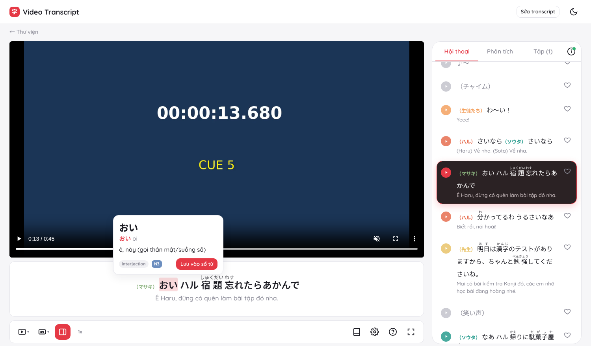

# Video Transcript học ngoại ngữ (MVP, lấy cảm hứng từ akaiwa.tv)

Dán link video (YouTube, trang video khác, file .mp4/.m3u8) hoặc tải file lên. Hệ thống tạo **transcript song ngữ có mốc thời gian theo từng câu**: câu gốc có furigana và romaji, bản dịch tiếng Việt, người nói, và phân tích từ vựng, kanji, ngữ pháp. Trang xem chạy transcript khớp với video.

```
akaiwa-transcript/
├── backend/                  FastAPI + pipeline Python
│   ├── app/main.py           API + phục vụ frontend
│   ├── app/jobs.py           hàng đợi job nền (thread pool, có trạng thái tiến trình)
│   ├── app/storage.py        lưu transcript JSON (thay bằng PostgreSQL/S3 khi lên production)
│   ├── app/pipeline/
│   │   ├── source.py         yt-dlp + ffmpeg (WAV 16 kHz mono), ưu tiên phụ đề có sẵn
│   │   ├── subtitles.py      đọc .srt/.vtt/.ass
│   │   ├── asr.py            faster-whisper / WhisperX (tuỳ chọn), lọc câu Whisper "bịa"
│   │   ├── cues.py           chia/gộp cue 1–7 s, ≤ 32 ký tự; nhận nhạc ♪ / tiếng động （…） / nhãn người nói
│   │   ├── diarize.py        pyannote (tuỳ chọn) → gán người nói theo độ chồng lấn
│   │   ├── japanese.py       SudachiPy: tách từ, furigana (tách okurigana), romaji Hepburn, kanji
│   │   ├── translate.py      Claude: dịch theo lô kèm ngữ cảnh + từ vựng/kanji/ngữ pháp (structured output)
│   │   ├── build.py          ghép JSON, màu người nói, mã phiên bản "sub 6/11 · e501ce"
│   │   └── run.py            điều phối các bước
│   └── tests/                pytest (17 test, không cần mạng/GPU)
├── frontend/                 HTML + JS thuần (ES modules), không cần build
│   ├── index.html            dán link / upload, tiến trình job, thư viện
│   ├── watch.html            trang xem 2 cột (video + phụ đề | Hội thoại / Phân tích / Tập)
│   └── edit.html             chỉnh sửa transcript, đổi tên nhân vật, dịch lại, xuất SRT/VTT/JSON
├── scripts/
│   ├── make_demo.py          tạo video demo + phụ đề tiếng Nhật mẫu
│   ├── seed_demo.py          chạy pipeline với video demo (LLM giả lập bằng demo_fixture.json)
│   └── demo_fixture.json
└── data/                     transcript, media, job (tự tạo khi chạy)
```

## Chạy thử

```bash
cd backend
pip install -r requirements.txt
```

```bash
python ../scripts/seed_demo.py
```

```bash
uvicorn app.main:app --port 8000
```

Mở http://localhost:8000. Video demo có sẵn ở trang xem: `/watch?v=demo-kansai-01`.



### Bật các bước dùng AI

| Bước | Cách bật | Ghi chú |
|---|---|---|
| Dịch và phân tích (Claude) | `export ANTHROPIC_API_KEY=...` | Model mặc định `claude-opus-5-5`, đổi bằng `LLM_MODEL`. Lô `LLM_BATCH_SIZE=30` cue, ngữ cảnh 6 câu trước và 3 câu sau. Có bật fallback phía server khi model từ chối. Không có key thì pipeline vẫn chạy, chỉ bỏ bước dịch và ghi cảnh báo. |
| ASR (video chưa có phụ đề) | `pip install faster-whisper`, hoặc `ASR_ENGINE=whisperx` + `pip install whisperx` | Mặc định `large-v3`, `vad_filter`, mốc thời gian từng từ. Nên có GPU. |
| Người nói | `pip install pyannote.audio` + `HF_TOKEN=...` | Chỉ chạy khi phụ đề không có sẵn nhãn （tên）. |

Chạy test:

```bash
cd backend && python -m pytest -q tests
```

## Pipeline

1. **Lấy nguồn.** Nếu YouTube có phụ đề tiếng Nhật làm tay thì tải phụ đề và bỏ qua ASR. Phụ đề tự động chỉ dùng khi bật tuỳ chọn. Upload kèm .srt/.vtt/.ass cũng bỏ qua ASR. Nếu không có phụ đề: tải audio, chuyển sang WAV 16 kHz mono, rồi chạy ASR.
2. **Chia cue** dài 1–7 s, tối đa khoảng 2 dòng. Tách tại dấu câu, khoảng lặng ≥ 0,6 s hoặc khi quá dài; gộp cue quá ngắn.
3. **Người nói.** Đọc trực tiếp nhãn （チエ） trong phụ đề, hoặc dùng pyannote. Cue nhiều người nói giữ nhãn trong câu.
4. **Loại cue:** `speech` / `music` (♪～) / `sfx` (（チャイム）, （笑い声）). Cue không lời thì không dịch và không phân tích.
5. **Furigana và romaji** cho từng từ. Ruby chỉ đặt trên kanji (忘れ → 忘{わす}れ).
6. **Dịch và phân tích:** mỗi lô 30 cue gửi một request kèm ngữ cảnh. Kết quả theo schema Pydantic (dịch, từ vựng, kanji On/Kun/Hán Việt, ngữ pháp, JLPT), giữ nhãn người nói "(Chie) Về nha.", dùng bảng thuật ngữ của series.
7. **Lưu JSON** có mã phiên bản (hash). Chạy dạng job nền có % tiến trình. Sửa tay trong `/edit`: câu nào đổi chữ sẽ được tách từ lại và đánh dấu "cần phân tích", sau đó bấm "Dịch lại".

Mỗi cue trong JSON có dạng:

```json
{"id": 5, "start": 12.0, "end": 16.5, "speaker": "マサキ", "type": "speech",
 "text": "おい ハル 宿題 忘れたらあかんで", "romaji": "oi haru shukudai wasuretara a kan de",
 "tokens": [{"surface": "宿題", "reading": "しゅくだい", "lemma": "宿題", "pos": "noun",
             "furigana": [["宿題", "しゅくだい"]], "romaji": "shukudai", "isWord": true}],
 "translation": "Ê Haru, đừng có quên làm bài tập đó nha.",
 "vocab": [{"lemma": "宿題", "reading": "しゅくだい", "meaning": "bài tập về nhà", "jlpt": "N5"}],
 "kanji": [{"char": "宿", "on": ["シュク"], "kun": ["やど"], "hanViet": "TÚC", "meaning": "trọ"}],
 "grammar": [{"pattern": "〜たらあかん", "meaning": "không được ~", "explanation": "...", "jlpt": "N4"}]}
```

## API

| Method | Đường dẫn | Mô tả |
|---|---|---|
| POST | `/api/jobs` | `{url, series, episode, lang, target, glossary, force_asr, allow_auto_subs}` |
| POST | `/api/jobs/upload` | multipart: `video`, `subtitle` (tuỳ chọn), `series`, `episode`, `glossary`… |
| GET | `/api/jobs`, `/api/jobs/{id}` | trạng thái, `stage`, `progress` %, cảnh báo |
| GET/PUT/DELETE | `/api/videos/{id}` | đọc / sửa (cue, nhân vật, series…) / xoá transcript |
| POST | `/api/videos/{id}/retranslate` | `{ids}` hoặc `{all:true}` |
| GET | `/api/videos/{id}/export.srt\|vtt\|json?lang=ja\|vi\|both` | xuất phụ đề |
| GET | `/api/series/{series}/episodes` | danh sách tập cho tab "Tập (N)" |

## Trang xem

- Player YouTube IFrame hoặc HTML5, đồng bộ mỗi 80 ms. Tìm cue bằng tìm kiếm nhị phân.
- Khung phụ đề dưới video, hoặc phụ đề nổi trên video, hoặc tắt.
- Chế độ **Xem / Đọc / Nói theo** (shadowing: dừng sau mỗi câu, đếm ngược theo độ dài câu rồi tự phát tiếp).
- Tab **Hội thoại**: nút ▶ màu theo người nói để tua tới câu, tim để lưu câu. Câu đang phát được tô sáng và tự cuộn vào giữa; hệ thống tạm ngừng tự cuộn 3 s nếu người dùng đang cuộn tay.
- Tab **Phân tích**: Từ vựng / Kanji / Ngữ pháp kèm số lượng. Cue nhạc hoặc tiếng động hiện thông báo "Cue này không có từ".
- Tab **Tập (N)**: các tập cùng series.
- Icon **(i)**: trạng thái đồng bộ (khớp / lệch thời lượng / video bị chặn nhúng), nguồn transcript, và chỉnh lệch ±0,1 s lưu theo từng video.
- **Tra từ**: rê chuột hoặc chạm vào từ để xem cách đọc, dạng từ điển, nghĩa, JLPT; nút "Lưu vào sổ từ" (xuất được CSV cho Anki).
- **Cài đặt** đầy đủ theo yêu cầu (màu, cỡ chữ, furigana, romaji, viền, bóng, độ đậm, phông, tốc độ, tự dừng cuối câu Tắt / Mỗi câu / Khi có từ mới, tra từ khi rê chuột), lưu bằng localStorage.
- Phím tắt: Space, ←/→, R, [ ], T, F, P. Có chế độ tối và giao diện mobile.

## Hướng phát triển

- Đổi `jobs.py` sang Celery/RQ/BullMQ, đổi `storage.py` sang PostgreSQL (bảng `subtitle_lines`, cột `tokens` dạng JSONB) và lưu media trên S3.
- Frontend có thể port sang Next.js: các hàm render (`cueTextHTML`, `rubyHTML`) và lớp `player.js` dùng lại được.
- Từ điển: nhập JMdict/KANJIDIC để tra offline. Khi đó LLM chỉ cần dịch nghĩa sang tiếng Việt.
- Giai đoạn sau: tài khoản (đồng bộ sổ từ và câu yêu thích), SRS, extension trình duyệt.

**Lưu ý bản quyền:** tải audio từ YouTube có thể vi phạm Điều khoản dịch vụ của YouTube. Chỉ xử lý video được phép sử dụng; video YouTube luôn phát qua trình nhúng chính thức.
